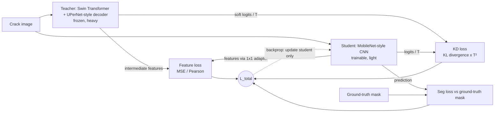

# How the student model is obtained from the teacher model

Paper: Wang, Su, Han, Zhang (2023). *A lightweight crack segmentation network based on knowledge distillation*. Journal of Building Engineering 76, 107200. https://doi.org/10.1016/j.jobe.2023.107200

> **Read this first: what this doc is based on.**
> I could not open the paper's full text. ScienceDirect blocked automated access and there is no open-access copy. So this doc uses three kinds of sources, and each section is tagged:
> - **[Confirmed]**: from the paper's title and published metadata.
> - **[Inferred from the reference list]**: the paper cites certain methods, such as Swin Transformer and MobileNetV2. That strongly suggests what the authors used, but I have not checked it against their text.
> - **[General KD]**: the standard knowledge-distillation recipe (Hinton et al. 2015, ref 42). It explains the idea, but it is not the paper's exact settings.
>
> I have not filled in any numbers (temperature, loss weights, parameter counts, mIoU). Read them from your own copy of the paper, which you can get through your library. Places to fill in are marked **TODO (check paper)**.

---

## 1. The big idea in one paragraph [General KD]

You first train a **large, accurate model (the teacher)** on the crack images. It segments well, but it is slow and heavy. Then you build a **small, fast model (the student)**. The student is *not* made by cutting pieces out of the teacher. It is a **separate, smaller network trained from scratch, or from ImageNet weights**. During training, the student learns from two sources:
1. the **ground-truth masks**: crack or not crack for each pixel, the normal way;
2. the **teacher's outputs and/or internal features**: the "knowledge" the teacher passes on.

Once training is done, you throw the teacher away and deploy only the student. So "getting the student from the teacher" means **training the student to imitate the teacher**. It does not mean shrinking the teacher.

## 2. The teacher [Inferred from the reference list]

The paper cites Swin Transformer (ref 30), Layer Normalization (31), GELU (32), Feature Pyramid Networks (33) and UPerNet / Unified Perceptual Parsing (47). That combination is the standard **Swin-Transformer backbone + UPerNet/FPN-style decoder** segmentation model, so the teacher is very likely a transformer-based segmenter of this kind. Transformers capture long-range context well, which helps with long, thin cracks. But they are heavy.
**TODO (check paper):** exact teacher variant (Swin-T/S/B?), decoder, parameter count, and accuracy.

## 3. The student [Inferred from the reference list]

The paper cites MobileNetV2 (34) and MobileNets (35). These are lightweight CNNs that use **depthwise-separable convolutions** and inverted residual blocks. So the student is very likely a MobileNet-style encoder with a light decoder.
Why it is smaller and faster [General]: a depthwise-separable conv splits a normal k×k conv into a per-channel k×k conv plus a 1×1 conv. That cuts the compute and parameters by roughly a factor of k² (about 8–9× for 3×3). The student also uses fewer channels and layers, and it avoids the expensive self-attention.
**TODO (check paper):** student design, params/FLOPs/FPS compared with the teacher.

## 4. What knowledge is transferred

### 4a. Output (logit) distillation, or "soft labels" [General KD; Hinton cited as ref 42]
For each pixel, the teacher outputs scores (logits) for crack and background. We soften them with a **temperature T**:

```
p_teacher = softmax(z_teacher / T)      p_student = softmax(z_student / T)
L_KD = T² · KL( p_teacher || p_student )   (averaged over all pixels)
```
A higher T gives "softer" probabilities. These tell the student *how sure* the teacher is, for example on blurry crack edges. A hard 0/1 label cannot carry that information.
**TODO (check paper):** whether they use pixel-wise KL, and the value of T.

### 4b. Feature distillation [Inferred: refs 36 and 43]
The paper cites *Distilling Knowledge via Knowledge Review* (ref 36, multi-level feature distillation from teacher to student). It also cites *General Distillation Framework ... via Pearson Correlation Coefficient* (ref 43, which matches **normalised** features using Pearson correlation, so that scale differences between heterogeneous networks do not matter). This strongly suggests that the student's **intermediate feature maps** are also trained to resemble the teacher's. Typically:
- A small **adapter** (a 1×1 conv) maps the student's features to the teacher's channel size.
- The two are compared with a distance such as MSE, or with Pearson correlation after normalisation.
- This matters more here because the teacher is a transformer and the student is a CNN, so their raw features look very different.
**TODO (check paper):** which stages are matched, which feature loss is used, and any attention-based term.

### 4c. Ground-truth loss [General]
A normal segmentation loss on the real masks, such as cross-entropy and/or Dice. Dice helps because crack pixels are rare.

### 4d. Total loss [General form]
```
L_total = L_seg(student, ground truth) + α · L_KD(logits) + β · L_feat(features)
```
α and β set how much the student listens to the teacher compared with the labels. **TODO (check paper):** the values of α and β.

## 5. Training procedure step by step [General KD + inferred details]

1. **Prepare data.** The paper cites the Özgenel concrete crack dataset (ref 39) and data augmentation (ref 40).
2. **Train the teacher** fully on the crack data, then **freeze** it.
3. **Build the student**, a MobileNet-style network, and add the adapters for feature matching.
4. **For each training batch:**
   - Run the image through the frozen teacher to get its logits and features. No gradients are computed here.
   - Run the same image through the student.
   - Compute L_seg, L_KD and L_feat, then sum them into L_total.
   - Backpropagate and update **only the student and its adapters**. The optimizer is likely AdamW (ref 38 is cited), implemented in PyTorch (ref 37).
5. **Evaluate** the student (mIoU/F1, params, FLOPs, speed). The paper also cites Grad-CAM (ref 49), probably to visualise what the student learned.
6. **Deploy only the student.** The adapters and the teacher are discarded.

## 6. Diagram



ASCII version:
```
 image ─┬─> [TEACHER (big, frozen)] ──features──┐   ──soft logits──┐
        │                                       v                  v
        └─> [STUDENT (small)] ──features─> feature loss    KD loss (T)
                     └──prediction──> seg loss <── ground truth
         total = seg + α·KD + β·feature   →  update STUDENT only
```

## 7. Why the student ends up nearly as good while being much smaller [General]
- Soft labels carry more information per pixel than hard labels, such as boundary uncertainty and thin-crack confidence.
- Feature matching gives the student "hints" in its middle layers. That makes training easier than learning from labels alone.
- At inference time, only the small student runs, so speed and memory are what the student needs, not the teacher.

## 8. Checklist for when you have the PDF
Look for these in the Method section: the teacher model name, the student model name, the loss equations (with α, β, T), which layers are distilled, the training epochs/lr/batch, and the results table (params, FLOPs, FPS, mIoU of teacher vs student vs student-without-KD). Then replace the TODOs above.
